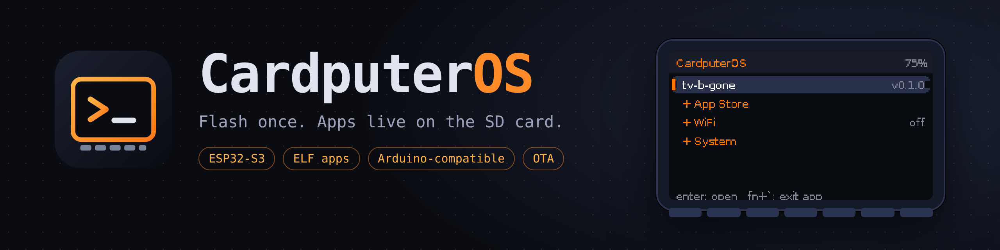
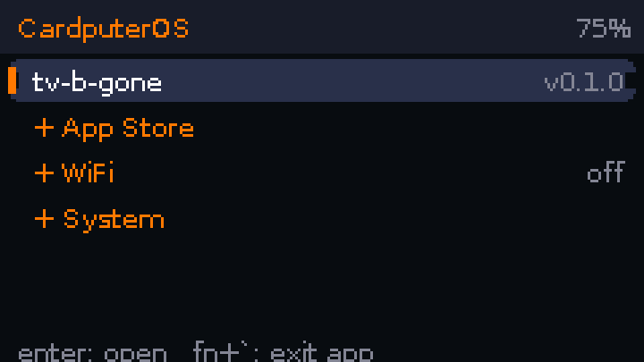
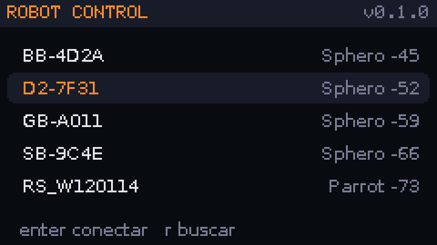
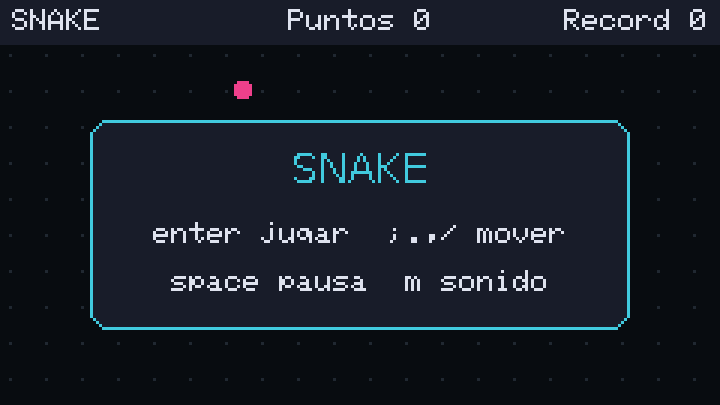
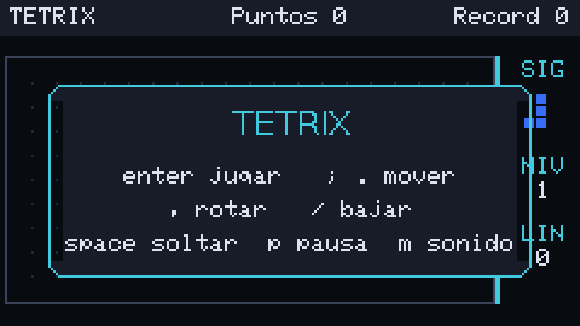

<p align="center">
  
</p>

<p align="center">
  <a href="https://github.com/AMasetti/CardputerOS/actions/workflows/build.yml"></a>
  <a href="https://github.com/AMasetti/CardputerOS/releases/latest"></a>
  <a href="LICENSE"></a>
  
  
  
  <a href="https://github.com/AMasetti/CardputerOS/stargazers"></a>
</p>

<p align="center">
  <a href="#flash-the-os-once">Flash</a> ·
  <a href="#apps">Apps</a> ·
  <a href="#writing-an-app">Write an app</a> ·
  <a href="docs/architecture.md">Architecture</a> ·
  <a href="CONTRIBUTING.md">Contribute</a>
</p>

# CardputerOS

A small operating system for the **M5Stack Cardputer ADV** (ESP32-S3, 8 MB flash, no PSRAM).
You flash it **once**. After that, apps are plain ELF files that live on the microSD card and are
installed, updated and launched from the device itself, with no re-flashing and no reboot.

* The OS owns every peripheral: display, keyboard, microSD, WiFi, battery, IMU, speaker/microphone,
  IR LED, GPIO. Apps never touch drivers; they call the OS through a versioned ABI table.
* Apps are loaded into RAM (code into executable RAM, data into normal RAM) by a small ELF loader.
  When an app exits, the OS gets back everything it used: memory, files, sockets, canvases, GPIO.
* Apps keep their **Arduino / M5Cardputer source code unchanged**. The SDK provides drop-in
  `M5Cardputer.h`, `Arduino.h`, `Preferences.h`, `SD.h`, `WiFi.h`, ... that call the OS.
* The OS itself lists releases of this repository on GitHub (tag `<app>-vX.Y.Z`, asset
  `<app>-vX.Y.Z.elf`), downloads apps to `/apps` on the SD card and can update itself over the air
  (tag `os-vX.Y.Z`, asset `os-vX.Y.Z.bin`).

<p align="center">
  
  
  
  
</p>
<p align="center"><sub>Screenshots from the QEMU emulator build.</sub></p>

## Apps

Install any of these from the on-device store (or copy the `.elf` to `/apps/` on the card).

| App | What it does |
|---|---|
| [`robot-control`](apps/robot-control) | One remote for toy robots and drones: Sphero BB-8, Ollie, R2-D2, R2-Q5, BB-9E, BOLT (BLE), Parrot Rolling Spider (BLE) and Jumping Sumo (WiFi, with live video) |
| [`ble-sentinel`](apps/ble-sentinel) | Passive BLE detector: Remote ID drones, smart glasses, trackers and more, by manufacturer-data signature |
| [`mp3-player`](apps/mp3-player) | iPod-style MP3 player with artists, albums, playlists and cover art |
| [`shell-rc`](apps/shell-rc) | BLE control for Shell Motorsport cars |
| [`wiz-rc`](apps/wiz-rc) | WiFi (UDP) remote for WiZ smart lights |
| [`led-rc`](apps/led-rc) | Infrared remote for generic RGB LED strips (24 and 44 key remotes) |
| [`tv-b-gone`](apps/tv-b-gone) | Turns TVs off over infrared |
| [`tuner`](apps/tuner) | Microphone tuner with cents meter and guitar/bass tunings |
| [`compass`](apps/compass) | IMU compass with a 3D wind-rose view |
| [`karting`](apps/karting) | GPS-less kart telemetry from the IMU: laps and g-forces |
| [`snake`](apps/snake), [`tetrix`](apps/tetrix) | Classic games, built for the 240x135 screen |
| [`ekoparty-badge`](apps/ekoparty-badge) | Conference badge with a QR code |

Apps are written in plain Arduino/M5Cardputer C++ and talk to the hardware only through the OS.

## Roadmap

- [x] ELF loader, app runner, versioned ABI, store and over-the-air OS updates
- [x] Bluetooth LE, TCP/UDP sockets, MP3/JPEG decoding in the OS
- [ ] Tested-on-hardware status for every app (most were validated in the emulator only)
- [ ] OS update rollback and signed releases
- [ ] Shortcuts and intents between apps


## Flash the OS (once)

Download `os-vX.Y.Z-full.bin` from the latest release and write it at address 0:

```bash
pip install esptool
python -m esptool --chip esp32s3 -b 460800 write_flash 0x0 os-vX.Y.Z-full.bin
```

Hold **G0** while plugging in USB if the board does not enter the bootloader by itself.
To build from source instead, see [Build](#build).

## First boot

1. Put a FAT32 microSD card in the Cardputer.
2. Open **+ WiFi**, pick your network and type the password (it is saved).
3. Open **+ App Store**: the OS reads the tags of this repository and offers every app.
   Select one and press Enter: it is downloaded to `/apps/` on the card and shows up in the launcher.
4. Select an app in the launcher and press Enter. **Fn + `** leaves the running app and returns to the launcher.

Keys in the OS menus: `;` up, `.` down, `,` left, `/` right, Enter select, `` ` `` back
(the arrows printed on the keycaps).

You can also copy `.elf` files to `/apps/` on the card yourself.

## Repository layout

```
os/        ESP-IDF project (the firmware)
  main/                  boot sequence
  components/cpos_hal/   display (ST7789), keyboard (TCA8418), SD, battery
  components/cpos_core/  ABI table, ELF loader, app runner, canvas engine + fonts, WiFi/IMU/audio/GPIO services
  components/cpos_ui/    launcher, text input, WiFi setup, app store, OS update
sdk/       everything an app needs
  include/cpos/abi.h     the ABI (single source of truth, shared with the OS)
  libc_exports.def       libc/libm functions exported to apps (generates stubs + table)
  shim/                  Arduino / M5Cardputer / SD / WiFi compatibility headers and runtime
  app.ld                 linker script for apps
  tools/build_app.py     builds apps/<name> into dist/<name>-vX.Y.Z.elf
apps/      the apps (one folder each: src/ + app.json)
tools/     font generator
```

## Build

Requirements: ESP-IDF 5.4.x for the OS, and the same toolchain (`xtensa-esp32s3-elf-gcc`) for apps.

```bash
# the firmware
cd os && idf.py set-target esp32s3 && idf.py build

# one app
python3 sdk/tools/build_app.py apps/snake        # -> dist/snake-v0.1.0.elf
```

Copy the `.elf` to `/apps/` on the SD card, or publish a release and install it from the store.

## Writing an app

`apps/<name>/app.json`:

```json
{ "name": "snake", "version": "0.1.0", "perms": ["audio_out"], "stack": 8192 }
```

`perms` lists the services the app is allowed to use (`sd`, `wifi`, `ble`, `audio_out`, `audio_in`,
`imu`, `ir`, `gpio`). The OS shows them before installing and blocks everything else.
`src/main.cpp` is ordinary Arduino-style code (`setup()` / `loop()`) using `M5Cardputer.h`.
Everything the OS needs (name, version, permissions, ABI version) is embedded in the ELF by the build tool.

### ABI and versions

`CPOS_ABI_MAJOR` changes when something is removed or changes meaning; `CPOS_ABI_MINOR` when
functions are appended (every table has reserved slots, so adding never moves existing entries).
An app records the minor it needs and the OS refuses apps from another major or a newer minor
with a clear message. Rebuild apps after an ABI major change.

## Releases and the store

CI (`.github/workflows/build.yml`) builds the OS and every app. On a push to `main` or `master`, each app/OS
version that has no release yet gets one: tag `<name>-vX.Y.Z`, asset `<tag>.elf` (apps) or `<tag>.bin`
(OS, plus `<tag>-full.bin` for first-time flashing). Bump `version` in `apps/<name>/app.json`
(or `os/version.txt`) to publish a new version.

## License

Apache-2.0 for the OS and SDK (see `LICENSE`). Third-party code keeps its own license:
QR code generator (MIT, `os/components/cpos_core/third_party/qrcodegen`), BMI270 microcode
(Bosch, BSD-3-Clause), the Helix MP3 decoder (RealNetworks, RPSL/RCSL,
`os/components/cpos_core/third_party/libhelix-mp3`), bitmap fonts generated from DejaVu (free license) and the classic 5x7 font
from Adafruit-GFX (BSD). Each app folder declares its own license when it differs.
